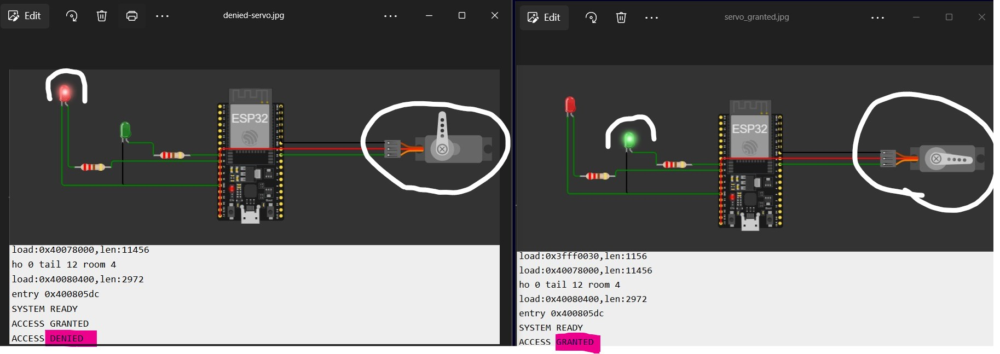

##### 11/9/2026

1. Servo Motor Integration:
A servo motor was added to the existing ESP32 access-control simulation in Wokwi to represent the door-lock mechanism.

The servo was connected to GPIO 18:
- 0°: Door locked.
- 90°: Door unlocked.
2. Firmware Updates:
The existing ESP32 firmware was updated to integrate servo control with the LED indicators.
Command	Green LED	Red LED	Servo
GRANTED	ON	OFF	90° (Unlocked)
DENIED	OFF	ON	0° (Locked)
Unknown	OFF	OFF	0° (Locked)

3. Problems Encountered and Solutions:
- Missing ESP32Servo library: Wokwi initially failed to compile because ESP32Servo.h was unavailable.
- Library Manager error: The Library Manager failed to load its library index.
- Solution: Instead of using an external library, servo control was implemented using the ESP32's built-in LEDC PWM functionality.
4. Current Status:
The updated firmware compiles and runs successfully in Wokwi. The servo rotates to 90° when access is granted, and the green LED illuminates simultaneously.
