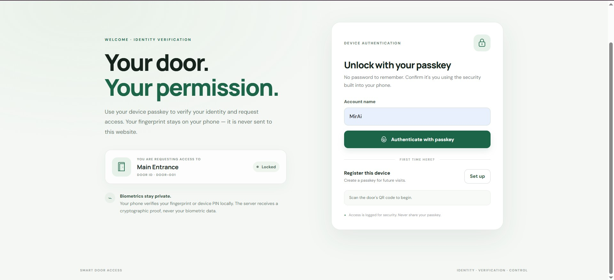

worked on "website" directory

## User flow

1. The user scans a fixed QR code with their phone's normal camera.
2. The QR opens this page with a door identifier, for example `https://your-domain.example/?door=door-001`.
3. The user registers a passkey once, or authenticates with an existing passkey.
4. The browser asks the phone's authenticator to verify the user (fingerprint, face, or device PIN depending on device settings).
5. The backend verifies the WebAuthn response and permission, then sends the access command to the ESP32 over USB Serial.
6. The user taps **Lock door** when finished. The backend sends the lock command to the ESP32.

The QR contains only the door identifier; it is not an authentication secret. The website never receives or stores fingerprint data.

## Files

- `index.html` — page structure and controls.
- `style.css` — responsive green-and-white visual design.
- `script.js` — door identifier parsing, browser WebAuthn calls, and API requests.

## Backend contract required

The JavaScript expects these same-origin JSON endpoints. They are integration contracts, not implemented by these static website files:

- `POST /api/v1/webauthn/register/options` — accepts `{ username, door_id }`; returns WebAuthn `PublicKeyCredentialCreationOptions` JSON with base64url-encoded binary fields.
- `POST /api/v1/webauthn/register/verify` — accepts `{ username, door_id, credential }`; verifies attestation and stores the credential public key, credential ID, user handle, and sign counter. It must not store biometric data.
- `POST /api/v1/webauthn/authenticate/options` — accepts `{ username, door_id }`; returns WebAuthn `PublicKeyCredentialRequestOptions` JSON with base64url-encoded binary fields.
- `POST /api/v1/webauthn/authenticate/verify` — accepts `{ username, door_id, credential }`; verifies the assertion, current access permission, challenge, origin, RP ID, signature, and user verification. On success it sends `GRANTED` to the ESP32 and returns `{ "status": "granted", "message": "..." }`.
- `POST /api/v1/access/lock` — accepts `{ door_id }`; requires an authenticated session and sends `LOCK` to the ESP32.

The backend should set an HttpOnly session cookie after successful authentication and use CSRF protection for state-changing requests. Configure the frontend and backend on the same origin (or explicitly configure CORS and credentials). WebAuthn requires HTTPS in deployment; `localhost` is allowed for local development.

## Copy into the existing project

Copy these three files into the existing `website/` folder:

```text
website/
├── index.html
├── style.css
└── script.js
```

Do not copy the old project's laptop-camera scanner or its password-login code. The phone's native QR scanner opens this page, and WebAuthn handles device authentication.

## Current limitation

The page and browser-side WebAuthn ceremony are prepared, but access will not work until the Python backend implements the endpoints above and connects verified access decisions to the ESP32 Serial protocol. The UI does not fake a successful authentication if the backend is unavailable.
