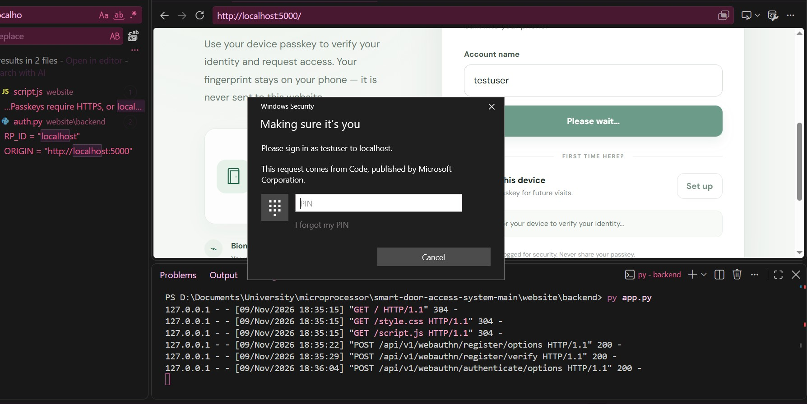
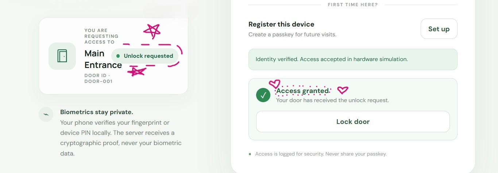

11/9/2026 night (thunderstorm~) <br>
# Backend and Data Layer
**Implementation status:** Completed locally


## 1. Backend Overview

developed a Python Flask backend to connect the website frontend with the authentication, authorization, and data-management layers.

The backend is responsible for:

- User identification.
- Passkey registration and authentication.
- Access-permission verification.
- Session management.
- Door lock/unlock requests.
- Access-event logging.

## 2. Project Structure

```text
website/
│
├── index.html
├── style.css
├── script.js
│
└── backend/
    ├── app.py
    ├── auth.py
    ├── storage.py
    ├── requirements.txt
    │
    └── data/
        ├── user.json
        ├── passkeys.json
        ├── permissions.json
        └── access_logs.json
```

## 3. Backend Modules

### `app.py` — Main Application

Built with Flask. It:

- Serves the website.
- Defines API endpoints.
- Coordinates authentication and authorization.
- Manages user sessions.
- Processes lock/unlock requests.
- Records access events.

### `auth.py` — Authentication Module

Implements WebAuthn/FIDO2 authentication.

Its responsibilities include:

- Generating registration challenges.
- Generating authentication challenges.
- Verifying registration responses.
- Verifying authentication signatures.
- Managing credential public keys and signature counters.

The system uses Windows Hello PIN as its authenticator.

**Configuration:**

| Parameter | Value |
|---|---|
| RP ID | `localhost` |
| Origin | `http://localhost:5000` |
| User verification | Required |
| Resident key | Required |

### `storage.py` — Data Management Module

Implements reusable JSON storage functions:

- `load_data()` — Reads stored JSON data.
- `save_data()` — Writes JSON data.
- `add_access_log()` — Adds a new access event.

Python's `json` and `pathlib` libraries are used for data persistence and file management.

## 4. Data Layer

We selected JSON files for the prototype instead of introducing a separate database system.

| File | Responsibility |
|---|---|
| `user.json` | Stores user identities and user IDs |
| `passkeys.json` | Stores registered WebAuthn credentials |
| `permissions.json` | Defines user-to-door access permissions |
| `access_logs.json` | Stores access events and timestamps |

**Example permission structure:**

```json
{
    "testuser": [
        "door-001"
    ]
}
```

This separates authentication from authorization: successfully verifying a user's identity does not automatically grant access to every door.

The backend must also verify that the authenticated user has permission for the requested door.

## 5. WebAuthn Registration and Authentication

### Registration Workflow

1. User enters their username.
2. Frontend requests registration options.
3. Backend checks the user's existence and door permission.
4. Backend generates a cryptographic challenge.
5. Browser requests device authentication.
6. Windows Hello verifies the user through their PIN.
7. Browser returns the credential response.
8. Backend verifies the response and stores the credential's public key and metadata.

### Authentication Workflow

1. User enters their username.
2. Backend retrieves the user's registered passkeys.
3. Backend generates a fresh authentication challenge.
4. Browser requests verification through Windows Hello.
5. Authenticator produces a cryptographic response.
6. Backend verifies the response.
7. Backend checks the user's door permission.
8. Backend creates an authenticated session if access is authorized.
9. Access event is recorded.

**Security and Privacy:** The PIN and biometric information remain on the user's device. The backend receives cryptographic proof rather than biometric data.

## 6. API Endpoints

The backend exposes the following endpoints:

| Method | Endpoint | Function |
|---|---|---|
| `GET` | `/` | Serves the website |
| `GET` | `/api/health` | Checks backend availability |
| `POST` | `/api/v1/webauthn/register/options` | Generates registration options |
| `POST` | `/api/v1/webauthn/register/verify` | Verifies and saves a passkey |
| `POST` | `/api/v1/webauthn/authenticate/options` | Generates authentication options |
| `POST` | `/api/v1/webauthn/authenticate/verify` | Verifies identity and authorizes access |
| `POST` | `/api/v1/access/lock` | Processes a lock request |

The frontend communicates with these endpoints through JSON requests and responses.

## 7. Access Logging

Each access event contains:

- Username.
- Door ID.
- Event type (`UNLOCK` or `LOCK`).
- Result.
- Timestamp.
- Operating mode.

**Example access log entry:**

```json
{
    "username": "testuser",
    "door_id": "door-001",
    "event": "UNLOCK",
    "result": "GRANTED",
    "timestamp": "ISO-8601 timestamp",
    "mode": "simulation"
}
```

These records provide a basic audit trail of access attempts and operations.

## 8. Implementation and Testing Results

### Locally Tested

| Component / Test | Result |
|---|---|
| Flask server | Successful |
| Website integration | Successful |
| API health check | Successful |
| User lookup | Successful |
| Permission verification | Successful |
| WebAuthn registration | Successful |
| Windows Hello PIN | Successful |
| Passkey authentication | Successful |
| Session management | Successful |
| Simulated unlock | Successful |
| Simulated lock | Successful |
| JSON access logging | Successful |

**Test account:** `testuser`

**Authorized door:** `door-001` — Main Entrance.

## 9. Current Limitations

The backend currently uses:

```python
SIMULATE_HARDWARE = True
```

This means authentication, authorization, and lock/unlock workflows have been tested in simulation mode.

**Physical door control has not yet been implemented.**

Other improvements needed before production deployment include:

- HTTPS configuration.
- CSRF protection.
- Secure session-secret management.
- Safer concurrent data storage.
- Hardware communication error handling.

## 10. Next Milestone: ESP32 Integration

The next development stage is connecting the backend to the ESP32 through serial communication.

### Intended Architecture

```text
         User
           |
           v
        Website
           |
           v
     Flask Backend
           |
           v
   WebAuthn Authentication
           |
           v
  Permission Verification
           |
           v
   Serial Communication
           |
           v
         ESP32
           |
           v
      Door Lock
           |
           v
    Hardware Response
           |
           v
      Access Logs
```

The ESP32 will receive authorized lock/unlock commands from the backend and control the physical locking mechanism.

For initial physical testing, a single LED can represent the lock state. The same firmware project will support both Wokwi simulation and physical ESP32 testing. Servo control may also be added as an optional hardware configuration later.

---

**Backend milestone complete:** We have implemented and locally tested the website-to-backend integration, WebAuthn authentication, authorization, JSON storage, sessions, and simulated door operations.

**Next:** ESP32 serial communication and physical door control.
